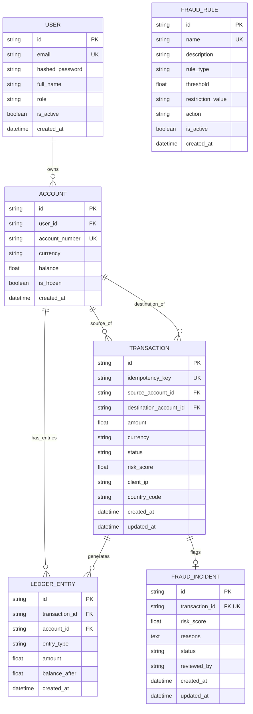

# SentinelFlow: Database Schema & Entity-Relationship Specification

## 1. Entity-Relationship Diagram

---

## 2. Table Specifications and Invariants

### 2.1 `transactions` Table
- **Index**: Unique B-tree index on `idempotency_key`.
- **Foreign Keys**: `source_account_id -> accounts(id)`, `destination_account_id -> accounts(id)`.
- **Constraint**: `amount > 0.0`.

### 2.2 `ledger_entries` Table
- **Immutability**: No `UPDATE` or `DELETE` operations are ever performed on this table.
- **Audit Invariant**: For every completed transaction $T$, $\sum \text{Debit}(T) = \sum \text{Credit}(T) = \text{Amount}(T)$.
- **Account Reconciliation**: $\text{Balance}(A) = \sum \text{Credit}(A) - \sum \text{Debit}(A) + \text{InitialBalance}(A)$.

### 2.3 `fraud_incidents` Table
- Tracks investigation lifecycle for rejected or flagged transactions.
- Provides compliance audit trail for financial regulators.
