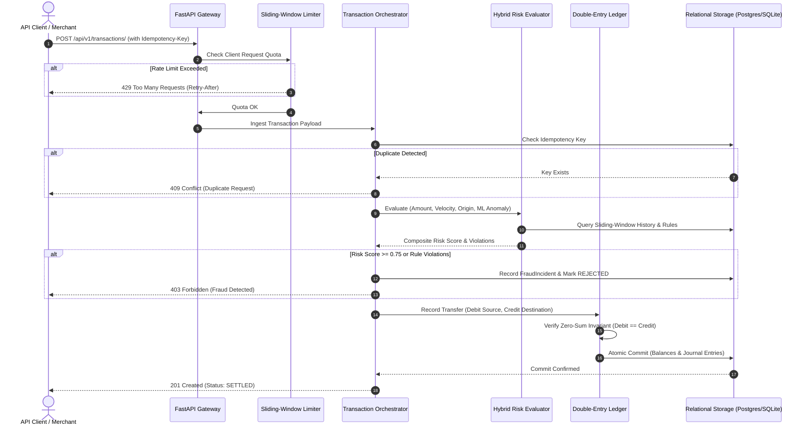

# SentinelFlow: High-Level System Architecture & Design Specification

## 1. Architectural Philosophy
SentinelFlow is architected around three foundational pillars required by modern enterprise fintech infrastructure:
1. **Mathematical Invariant Preservation**: Every balance mutation is grounded in immutable, balanced double-entry ledger journals.
2. **Deterministic & Statistical Risk Defense**: Blending low-latency sliding-window heuristic rules with unsupervised machine learning anomaly scoring.
3. **Resilience under Concurrency**: Defending against duplicate submissions via unique idempotency keys and isolating upstream external services using circuit breakers.

---

## 2. End-to-End Transaction Sequence Diagram

---

## 3. Subsystem Breakdown

### 3.1 Idempotency & Concurrency Controller
Network disruptions frequently cause clients to retry payment API calls. Without idempotency, users risk double charges. SentinelFlow requires an `Idempotency-Key` header on all mutation endpoints, indexing transactions by key to guarantee strict at-most-once processing semantics.

### 3.2 Double-Entry Journaling Engine
Traditional single-column balance architectures (`UPDATE accounts SET balance = balance - 100`) suffer from silent data corruption during system crashes. SentinelFlow records every financial event as two balancing ledger entries:
- A `DEBIT` entry against the payer account.
- A matching `CREDIT` entry against the payee account.
The sum of credits minus debits is continually verifiable using the ledger audit endpoint.

### 3.3 Hybrid Risk Evaluator
Combines:
- **Velocity Filters**: Real-time sliding window counting in memory or Redis to mitigate carding and brute-force testing attacks.
- **Dynamic Policy Rules**: Hot-reloadable rules configured via database without service redeployment.
- **Isolation Forest Scorer**: Evaluates multivariate outliers in transaction feature space (amount, time of day, geographic origin).
